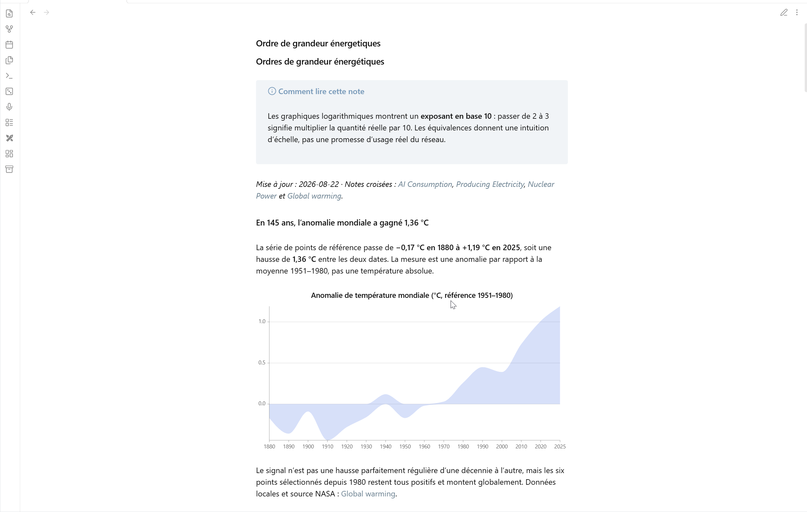
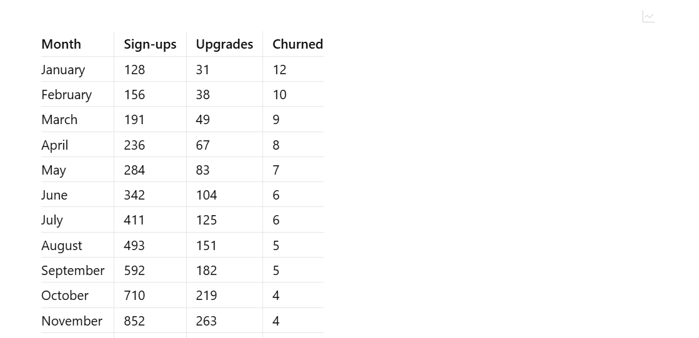
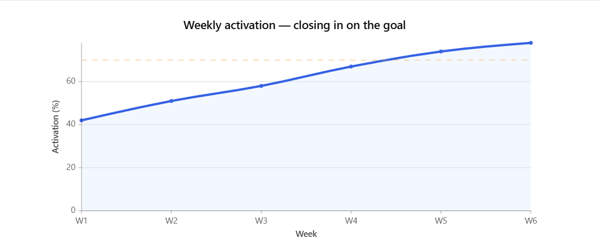
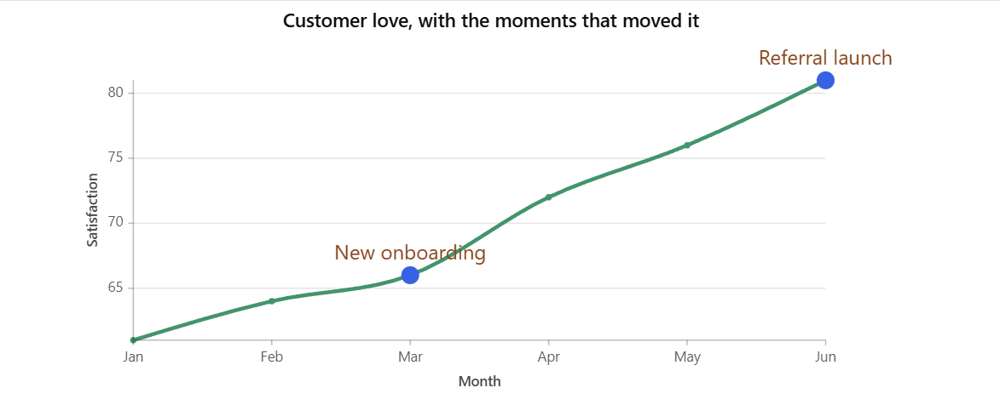
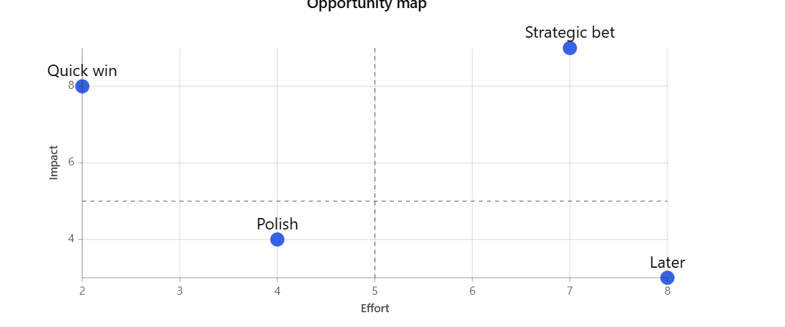

# GoodCharts

### Turn the data in your Obsidian notes into clear, interactive stories.

No spreadsheet detours. No chart software to learn. Keep your evidence, writing, and visuals together in one note.

## See the story in your data

GoodCharts helps you:

- **Spot trends** while researching or taking notes
- **Compare evidence** without leaving Obsidian
- **Call out turning points** that matter to your story
- **Keep charts connected to their source data**
- **Ask an AI assistant** to create richer visuals for you

Ideal for journalists, students, researchers, writers, and anyone who thinks in notes—not dashboards.

## From table to chart in one click

Write or paste a simple table, then switch between the source data and an interactive chart. Your table stays intact and editable.

Update a number in your note and the chart updates with it. Hover to explore values, then switch back to the table whenever you want to check the evidence.

## Answer real questions visually

**Are we moving toward the goal?**

**What changed—and what caused it?**

**Where should we act first?**

Compare outcomes, show goals, and mark important events—all beside the notes that explain them.

## Start in three steps

1. Install and enable GoodCharts in Obsidian.
2. Add a table to a note.
3. Open Reading view and select the chart button.

That is enough for your first chart.

## Want something more expressive?

Ask your AI assistant for a GoodCharts visual in plain language:

> “Turn these survey results into a chart and highlight the two biggest changes.”

The included [GoodCharts Agent Skill](./skills/goodcharts/SKILL.md) helps compatible AI assistants create custom charts safely while keeping everything readable in your note.

## Install

Until GoodCharts is available in Obsidian's Community Plugins directory, download the files from the [latest release](https://github.com/Times0/good-charts/releases/latest) and copy them to:

`<your-vault>/.obsidian/plugins/goodcharts/`

Reload Obsidian, then enable **GoodCharts** under **Settings → Community plugins**.

---

Have an idea or found a problem? [Open an issue](https://github.com/Times0/good-charts/issues).

Powered by [TanStack Charts](https://tanstack.com/charts/latest). Released under the [MIT License](./LICENSE).