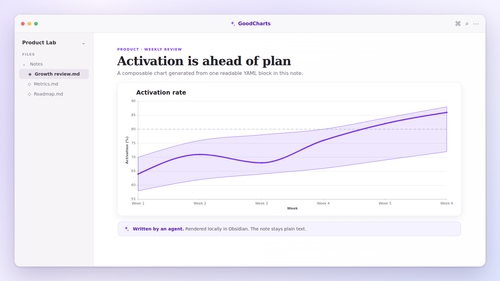
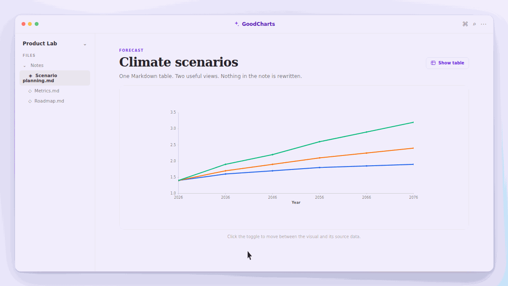
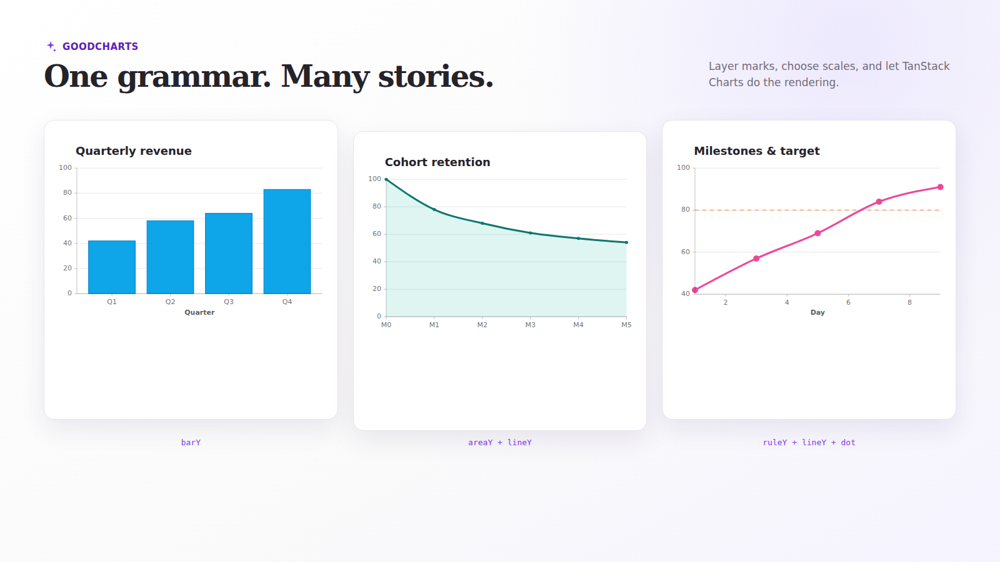

<div align="center">

# GoodCharts

### Charts your agents can write. Charts your notes can keep.

Create expressive, composable charts in Obsidian from readable YAML—or turn an ordinary Markdown table into a chart with one click.

[](https://github.com/Times0/good-charts/releases/latest)
[](./LICENSE)
[](https://tanstack.com/charts/latest)

</div>



## Built for agents, by design

GoodCharts is primarily an authoring surface for agents. Its plain-text YAML is easy to generate, review, diff, and keep in a note—without asking an agent to write JavaScript or modify your vault UI.

The repository includes a [GoodCharts Agent Skill](./skills/goodcharts/SKILL.md) with the supported grammar, composition patterns, and guardrails. Install it with any compatible agent-skills client:

```bash
npx skills add Times0/good-charts
```

Humans can write the same blocks directly; the format is intentionally small enough to understand at a glance.

## Philosophy: one grammar, many charts

[TanStack Charts](https://tanstack.com/charts/latest) is built around a composable chart grammar rather than a shelf of fixed chart components. That is exactly the right foundation for agent-authored charts: combine marks, scales, data, and annotations to express the story instead of searching for a narrowly named chart type.

GoodCharts exposes a focused, safe subset of that grammar in YAML today, while keeping the door open to far more chart forms as TanStack Charts evolves.

## Quick start

Add a fenced `goodcharts` block to any note:

````markdown
```goodcharts
title: Weekly activation
height: 320

data:
  - week: Week 1
    activation: 64
  - week: Week 2
    activation: 71
  - week: Week 3
    activation: 68
  - week: Week 4
    activation: 76

marks:
  - lineY:
      x: week
      y: activation
      stroke: "#7c3aed"
      strokeWidth: 4
      points: true
      curve: monotoneX

x:
  scale: point
  axis:
    label: Week

y:
  scale: linear
  nice: true
  grid: true
```
````

GoodCharts renders it in reading view with an accessible label and tooltips by default. The note remains portable Markdown and YAML.

## Markdown table in, interactive chart out

Already have data in a table? Leave it there. Any Markdown table with a label column and at least one numeric column becomes a chart in reading view. The first column is the X-axis; every numeric column becomes a line series.



```markdown
| Year | Optimistic | Normal | Pessimistic |
|------|------------|--------|-------------|
| 2026 | 1.4        | 1.4    | 1.4         |
| 2046 | 1.7        | 1.9    | 2.2         |
| 2076 | 1.9        | 2.4    | 3.2         |
```

The **Show table / Show chart** toggle only changes the view. It never rewrites the note. Thousands separators are accepted, and empty or non-numeric cells create gaps.

## Compose the story you need



Marks are layers. Put several in one block to build richer explanations:

| Intent | Compose | Recommended X scale |
|---|---|---|
| Compare categories | `barY` | `band` |
| Show a trend | `lineY` or `lineY` + `dot` | `point` or `linear` |
| Show a range | `areaY` + `lineY` | `point` or `linear` |
| Add a target | `ruleY` + any data mark | match the data mark |
| Label an event | `ruleX` + `text` | match the data mark |

Here is the pattern behind the hero image: an expected range, a target, and the actual result are three independent layers sharing one chart.

````markdown
```goodcharts
title: Activation rate
ariaLabel: Weekly activation rate with expected range and goal

data:
  weeks:
    - { week: Week 1, activation: 64, low: 58, high: 70 }
    - { week: Week 2, activation: 71, low: 62, high: 76 }
    - { week: Week 3, activation: 68, low: 64, high: 78 }
    - { week: Week 4, activation: 76, low: 66, high: 80 }

marks:
  - areaY:
      data: weeks
      x: week
      y1: low
      y2: high
      fill: "#8b5cf6"
      fillOpacity: 0.15
      curve: monotoneX

  - ruleY:
      data: [80]
      stroke: slategray
      strokeDasharray: 7 7

  - lineY:
      data: weeks
      x: week
      y: activation
      stroke: "#7c3aed"
      strokeWidth: 4
      points: true
      curve: monotoneX

x:
  scale: point
y:
  scale: linear
  nice: true
  grid: true
```
````

<details>
<summary><strong>Grammar reference</strong></summary>

### Marks and scales

Supported marks are `lineY`, `areaY`, `barY`, `dot`, `ruleX`, `ruleY`, and `text`.

Supported scales are `linear`, `band`, and `point`. Use `band` for bars; GoodCharts adds sensible spacing automatically. `curve: monotoneX` is the available curve helper.

Optional Obsidian presentation fields are `title`, `height`, and `ariaLabel`. Height defaults to 300 pixels. The accessible label falls back to the title and then to `Chart`. Set `tooltip: false` to disable the default tooltip.

### Data shapes

Use a root array when every mark shares one data set. Marks inherit it when they omit `data`:

```yaml
data:
  - { category: A, value: 12 }
  - { category: B, value: 18 }

marks:
  - barY:
      x: category
      y: value

x:
  scale: band
y:
  scale: linear
```

Use a root mapping when marks need different named data sets, then select one with `data: name`. Inline arrays are useful for annotations such as `ruleY: { data: [80] }`.

### Colors

Use `stroke` for lines and rules, and `fill` for bars, areas, dots, and text. Quote hex values because `#` begins a YAML comment.

For grouped series, use TanStack's chart-level `color.domain` and `color.range`; a mark's `z` or `color` channel supplies the series value:

```yaml
color:
  domain: [Actual, Forecast]
  range: ["#2563eb", tomato]

marks:
  - lineY:
      x: week
      y: value
      z: series
```

When `color` is omitted, TanStack Charts supplies its default palette.

### Safety and current scope

GoodCharts never evaluates JavaScript from notes. Functions, accessors, responsive builders, tick formatters, transforms, polar marks, date/time scales, and configured scale instances are not currently supported. Other static axis, grid, layout, and mark options pass through to TanStack Charts.

</details>

## Installation

### Obsidian Community Plugins

Once GoodCharts is available in the community directory:

1. Open **Settings → Community plugins**.
2. Select **Browse** and search for **GoodCharts**.
3. Select **Install**, then **Enable**.

### Manual installation

Download `main.js`, `manifest.json`, and `styles.css` from the [latest release](https://github.com/Times0/good-charts/releases/latest). Put them in `<vault>/.obsidian/plugins/goodcharts/`, reload Obsidian, and enable the plugin.

## Development

GoodCharts uses [Bun](https://bun.sh/):

```bash
bun install
bun run verify
```

`bun run build` creates `main.js` in the repository root. To deploy a development build to a vault, pass the vault directory or set `OBSIDIAN_VAULT`:

```bash
bun run deploy --vault=/path/to/vault
```

## Contributing

Contributions are welcome. Keep changes focused, add or update tests for behavior, and run `bun run verify` before opening a pull request. For visual changes, include a screenshot or short recording so reviewers can evaluate the result quickly. Bugs and feature ideas belong in the [issue tracker](https://github.com/Times0/good-charts/issues).

## Acknowledgements

Rendering is powered by [TanStack Charts](https://tanstack.com/charts/latest), Preact, and D3 Shape. GoodCharts is an independent community plugin and is not affiliated with or endorsed by TanStack or Obsidian.

Released under the [MIT License](./LICENSE).
